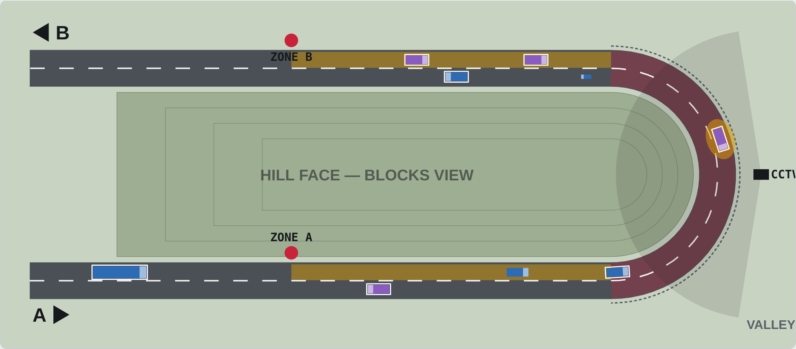
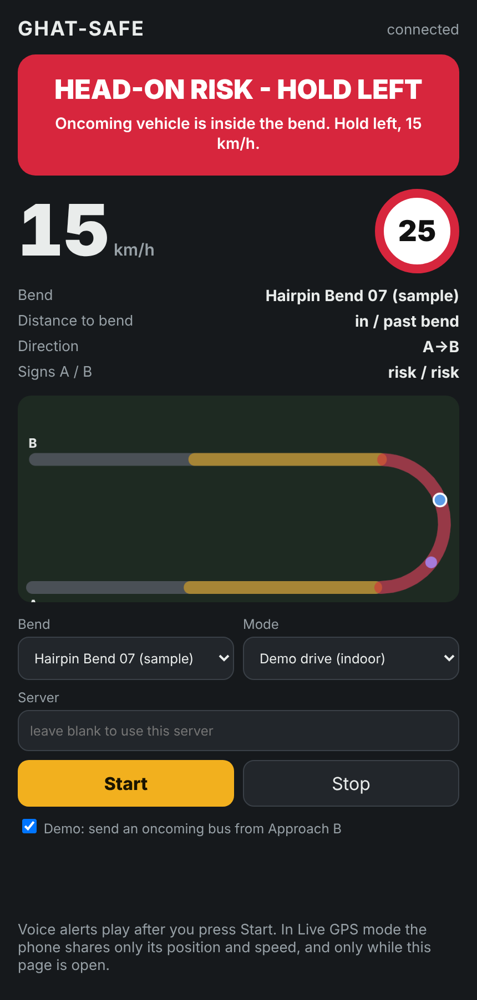

# GHAT-SAFE — Software Blind-Curve Warning for Ghat Roads

**Team CE Endeavours** · Department of Civil Engineering, K.S.R.M. College of Engineering (Autonomous), Kadapa
**Innovators Conclave 2026** · Domain: **Smart Cities & CivilTech** · Challenge: **IC26-04-10 Open CivilTech Innovation** · Project type: **Software**

| Team member | Reg. No. | Semester |
|---|---|---|
| Sunkesula Ameer Besha | 249Y1A0134 | V |
| Bukke Balu Naik | 259Y5A0103 | V |
| Maddineni Venkata Siva Narayana | 259Y5A0122 | V |

---

## The problem

On ghat roads, the hill face at a hairpin bend hides an oncoming vehicle until it is a few metres away. Steep gradients, narrow lanes, rain, fog and overspeeding make head-on collisions at these bends common, and a roadside sign alone is easy to miss at night. India recorded 4,80,583 road accidents and 1,72,890 deaths in 2023 (MoRTH, *Road Accidents in India 2023*).

Hardware warning systems (sensors + microcontroller + LED boards) work, but every bend needs poles, solar power, wiring and maintenance on a remote hillside.

## Our solution

GHAT-SAFE does the same job — **Detect, Warn, Guide** — entirely in software:

| Function | Hardware approach | GHAT-SAFE (software) |
|---|---|---|
| Detect | IR / radar sensors at each approach | Phone GPS crossing a geofenced approach zone + AI detection on existing CCTV |
| Decide | Arduino at the roadside | Cloud bend-state engine, updated every second |
| Warn | LED board on the opposite approach | Full-screen alert + voice in the driver app |
| Monitor | Site visits | Authority dashboard: alerts, overspeed, near-misses |

| Simulator | Driver app |
|---|---|
|  |  |

### Warning states

| State | When | Driver hears |
|---|---|---|
| **CLEAR** | No vehicle in the opposite approach zone | "Hairpin bend ahead. Keep below 25." |
| **VEHICLE AHEAD** | A vehicle is in the opposite approach zone | "Vehicle approaching from the other side. Slow down." |
| **HEAD-ON RISK** | The oncoming vehicle is already inside the blind bend | "Danger. Oncoming vehicle in the bend. Keep left and slow to fifteen." |
| **OVERSPEED** | Driver enters the zone > 5 km/h above advisory | "You are over the safe speed for this bend." |

### Engineering basis — zone length from stopping sight distance

```
SSD       = v·t + v² / (2·g·f)      t = 2.5 s, v = 40 km/h approach speed
Geofence  = SSD + v × 2 s           (GPS update + mobile network delay)
```

| Condition | Advisory | f | SSD | Geofence |
|---|---|---|---|---|
| Clear | 25 km/h | 0.40 | 43.5 m | 66 m |
| Rain / wet | 20 km/h | 0.30 | 48.8 m | 71 m |
| Fog / night | 20 km/h | 0.35 | 45.8 m | 68 m |

## Architecture

```
 Driver app (phone GPS, 1 Hz) ─┐                         ┌─► Driver alert (screen + voice)
                               ├─► Bend-state engine ────┤
 Existing CCTV (YOLO counts) ──┘    (FastAPI, Python)    └─► Authority dashboard + event log
```

## Repository layout

```
backend/        FastAPI server and bend-state engine (Python)
  engine.py       geofencing, SSD, warning logic — no web dependencies
  main.py         REST + WebSocket API, also serves the two web apps
  bends.json      bend geometry (sample hairpin; replace with surveyed points)
  tests/          pytest unit tests for the engine
driver-app/     Driver app (mobile web): live GPS mode and indoor demo drive
web/            Simulator + authority dashboard (runs with no server too)
cctv/           CCTV vehicle-counting module (YOLO + OpenCV), prototype
docs/           Presentation (PPTX) and screenshots
```

## Run it

Requires Python 3.10+.

```bash
cd backend
pip install -r requirements.txt
uvicorn main:app --reload --port 8000
```

Then open:

- `http://localhost:8000/` — **simulator and authority dashboard**
- `http://localhost:8000/driver/` — **driver app**. Choose *Demo drive* and press **Start**: your car drives from Approach A while a bus comes from Approach B; watch the alert change from CLEAR → VEHICLE AHEAD → HEAD-ON RISK, with voice.
- `http://localhost:8000/docs` — interactive API documentation

The simulator (`web/index.html`) also works by simply opening the file in a browser, with no server.

**Run the tests**

```bash
cd backend
python -m pytest -q
```

**Live GPS on a phone:** browsers allow GPS only on HTTPS or localhost. Deploy the backend to any HTTPS host (for example Render or Railway), or use a tunnel such as `ngrok http 8000`, and open `/driver/` on the phone.

**CCTV module (optional):**

```bash
cd cctv
pip install -r requirements.txt
cp regions.example.json regions.json   # then draw the three regions for your camera view
python detector.py --source bend07.mp4 --server http://localhost:8000 --bend bend-07 --show
```

## API summary

| Method | Path | Purpose |
|---|---|---|
| GET | `/api/bends` | List bends |
| GET | `/api/bends/{id}` | Bend geometry and live state |
| GET | `/api/bends/{id}/state` | Signs for Approach A and B, occupancy |
| POST | `/api/bends/{id}/weather` | Set `clear`, `rain` or `fog` |
| POST | `/api/report` | Phone GPS fix → returns that driver's alert |
| POST | `/api/cctv/{id}` | Vehicle counts from the camera |
| GET | `/api/events` | Alert / overspeed event log |
| WS | `/ws/{id}` | Bend state pushed every second |

## Simulation results

From the simulator, 3 simulated hours per scenario, moderate traffic, clear weather. *Near-miss* = opposing vehicles meet inside the blind bend at a closing speed above 40 km/h.

| Scenario | Near-miss rate |
|---|---|
| System off | 16.7 % |
| 30 % app use, no CCTV | 5.5 % |
| 30 % app use + CCTV | 2.3 % |
| 60 % app use, no CCTV | 0.6 % |
| 60 % app use + CCTV | 0.5 % |

These are model results that test the logic. Real benefit must be measured in a field pilot.

## Assumptions and limits

- Drivers without the app are invisible unless a camera covers the bend; CCTV is part of the design for this reason.
- Phone GPS is accurate to about 3–10 m and weakens under cliffs. The system warns about presence, not lane position.
- Mobile signal is patchy on ghat roads; on-phone geofences (planned) and the CCTV path reduce this risk.
- Alerts are voice-first to limit distraction.
- GHAT-SAFE adds a layer on top of signs, chevrons, mirrors, markings and crash barriers. It does not replace them.
- `bends.json` contains a generated sample hairpin, not a surveyed bend.

## Execution-day plan (Day 2)

1. Load geometry of a real ghat-road hairpin into `bends.json`.
2. Run the driver app on two phones over HTTPS and show a live oncoming warning.
3. Add authority dashboard view fed by `/api/events` and `/ws/{id}`.
4. Add Telugu and Hindi voice prompts.
5. Calibrate the CCTV module on recorded bend footage.

## Stakeholders

AP Roads & Buildings Department and NHAI (bend data, approvals), Ministry of Road Transport & Highways (road-safety programmes), traffic police (enforcement data), APSRTC (first driver group).

## License

MIT — see [LICENSE](LICENSE).
